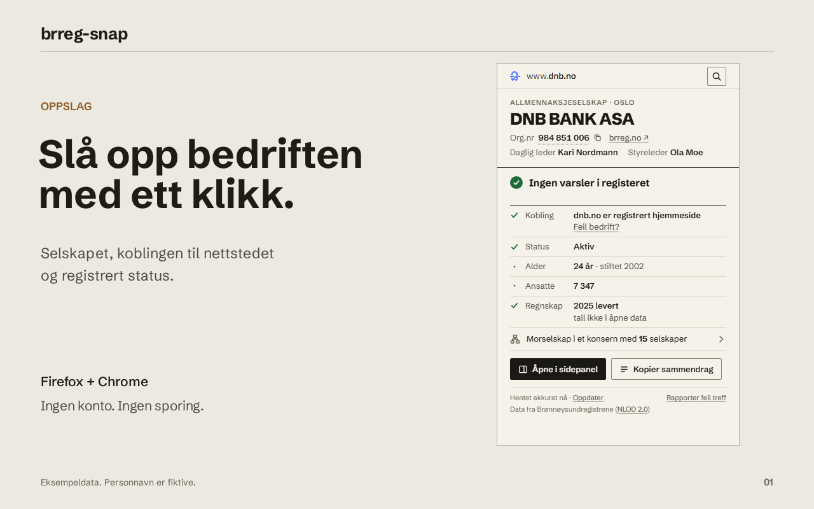

# brreg-snap

Oppslag i Brønnøysundregistrene, rett fra nettsiden du er på.
brreg-snap slår opp bedriften bak siden, viser hvordan siden henger
sammen med den, og henter det viktigste fra registeret: org.nr,
status, ledelse, regnskap, konsern og eventuelle varsler.

**Installer:** [Firefox Add-ons](https://addons.mozilla.org/firefox/addon/brreg-snap/) (Firefox 115 eller nyere)
· [Chrome Web Store](https://chromewebstore.google.com/detail/brreg-snap/mccggmiialopdaaokhakeijmbafhdmli) (Chrome 116 eller nyere)



*A Firefox and Chrome extension for lookups in Norway's Brønnøysund
Register Centre, right from the site you are on: the company behind
it, its organisation number, status, management, accounts, group and
any registry warnings.*

## Hva du ser

- **Svaret.** «Ingen varsler i registeret», et tydelig varsel, eller
  «Alvorlig» i rød ramme ved konkurs, sletting, tvangsavvikling, eller
  når siden oppgir en bedrift som har en annen nettside i registeret.
  Ingen varsler er ingen garanti for at en butikk er trygg.
- **Kobling.** Hvorfor akkurat denne bedriften: siden er dens
  registrerte hjemmeside, siden oppgir org.nr selv, eller det er bare
  et navnetreff.
- **Status, alder, ansatte og siste regnskap**, og konsernet hvis det
  finnes et.

Sidepanelet går dypere: roller, regnskap med omsetning og resultat
over flere år, årsrapporter og kunngjøringer, konsern og underenheter.
Du kan også søke på navn eller org.nr, markere tekst og slå den opp
med høyreklikk, eller bruke Alt+Shift+O (Control+Shift+O på Mac).

Ingen konto, ingen sporing. Oppslagene går bare til `data.brreg.no`,
aldri til utvikleren.

## How it finds the company

There is no domain-to-company table. Company data comes from the
register's open API (Enhetsregisteret for units, roles and groups;
Regnskapsregisteret for accounts and annual-report copies); company
data and each site's lookup result are cached for up to 24 hours in
`storage.session`, cleared when the browser closes. The steps:

1. An organisation number named in the page address (`?orgnr=`) wins.
2. Otherwise a single mod-11-valid number in the address, then in the
   title. Two different valid numbers in the same place means no answer
   from that place: a product id that happens to pass the checksum must
   not name the wrong company.
3. Otherwise parallel searches on the domain (against registered
   websites) and the site's main word (against names), with each
   candidate scored on how its registered website and legal name tie
   to the site.

When several companies fit equally well, a picker asks instead of
guessing, and a wrong match can be replaced. The register's quirks the
code depends on (accounts on a separate API base, banks' accounts
answering 500) are written down in
[docs/notes/brreg-api.md](docs/notes/brreg-api.md); the cascade in
[docs/notes/resolution.md](docs/notes/resolution.md).

## Security model

The extension has no content scripts: it never injects code into the
pages you browse and never reads their DOM. The only server it talks to
is `data.brreg.no`.

| Permission | Why |
|---|---|
| `activeTab` | Read the current tab's address and title, **only when you click the button or the sidebar icon, use a right-click item or press a shortcut** |
| `storage` | Cache company data and lookup results for up to 24 hours in `storage.session` (cleared when the browser closes), keep your 5 most recent companies there, and store the «Auto-oppdater» setting in `storage.local` |
| `menus` (Firefox) / `contextMenus` + `sidePanel` (Chrome) | The right-click items, and the side panel on Chrome |
| `host_permissions: https://data.brreg.no/*` | The public brreg API. The only host |
| `optional_permissions: tabs` | **Off by default and not in the install dialog.** Requested only when you turn on «Auto-oppdater» in the panel and confirm the notice about what will be sent, so an open panel can follow your active tab. Turning it off gives the permission back |

On Chrome, only the `data.brreg.no` host permission shows an install
warning. `tabs` appears as "Read your browsing history" when you opt
in.

No `<all_urls>`, `cookies` or `webRequest`. No `eval`, no `Function()`, no remote code,
and a strict CSP (`default-src 'self'`, `connect-src https://data.brreg.no`).
No runtime dependencies. No analytics, trackers or telemetry.

To find the company, the extension sends the site's registrable domain
(`dnb.no` on `nettbank.dnb.no`; on some known hosting platforms, such
as `github.io`, the site's own name there: `firma.github.io`) and its
main word, an organisation number, or text you search for or select
and look up. A selection that holds exactly one valid organisation
number sends only that number. Never the full address, the page title
or cookies. IP addresses and reserved local names (`localhost`, names
without a dot, endings like `.local` or `.lan`) are never sent; other
names that only work on a private network are looked up like any other
site. Nothing goes to the developer. Firefox declares this as
`browsingActivity` data collection, the Chrome Web Store as web
history. [PRIVACY.md](PRIVACY.md) has the details.

## Tests

- `pnpm verify` is the gate, run by
  [CI](https://github.com/ikkeseb/brreg-snap/actions/workflows/ci.yml)
  and by a pre-push hook:
  typecheck, ESLint with zero warnings, Vitest unit tests, a check that
  every path the docs name exists, both builds, checks on the built
  packages, and `web-ext lint`.
- `tests/manifest.test.ts` pins permissions, hosts, CSP and the data
  declarations on the source manifests, and `pnpm verify:dist` checks
  the built ones against the same rules. Adding a host, a content
  script or a permission fails the gate.
- `pnpm smoke` loads the built Chrome extension in Chromium with
  Playwright and runs a lookup from toolbar click to side panel, against
  recorded fixtures. CI runs it on every push and pull request to main
  and dev. The store screenshots come from a local run of the same
  smoke.
- A weekly canary (`pnpm test:live`) checks the brreg API facts the code
  relies on and runs a corpus of real sites through the shipped
  resolver, where a confident wrong company is the failure that counts.
  A failure opens an issue.

Release packages are built by CI from the tag and are reproducible
([BUILD.md](BUILD.md)).

## Develop

Requires Node (version range in `package.json` `engines`),
[pnpm](https://pnpm.io/), and Firefox and/or Chrome.

```bash
pnpm install
pnpm dev        # build + launch a Firefox profile with the extension
pnpm verify     # the full gate
```

`pnpm install` also sets this clone's `core.hooksPath` to
`.githooks/`, whose pre-push hook runs `pnpm verify`
(`git push --no-verify` skips it).

- [docs/release.md](docs/release.md): releasing and store publishing
- [docs/notes/platform.md](docs/notes/platform.md): Firefox and Chrome
  differences
- [AGENTS.md](AGENTS.md): guidance for coding agents

Open an issue before a non-trivial change. PRs that add content
scripts, add hosts or relax the CSP will be closed. GitHub Releases
carry the unsigned build artifacts and the source zip for each tag;
install from the stores.

Support: [sebastian@nuez.no](mailto:sebastian@nuez.no) or a GitHub
issue. Security reports go privately, through
[SECURITY.md](SECURITY.md).

## License

[MIT](LICENSE). The bundled typeface Schibsted Grotesk (Bakken & Bæck /
Schibsted) is under the [SIL Open Font License 1.1](public/fonts/OFL.txt).
